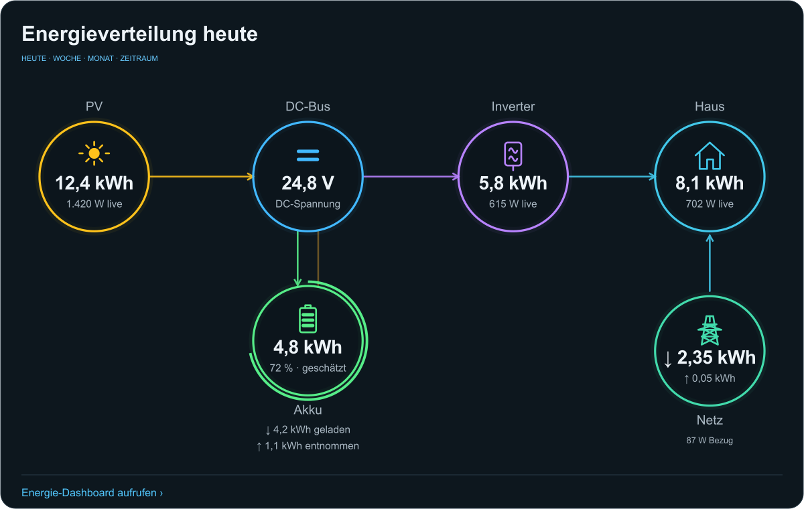
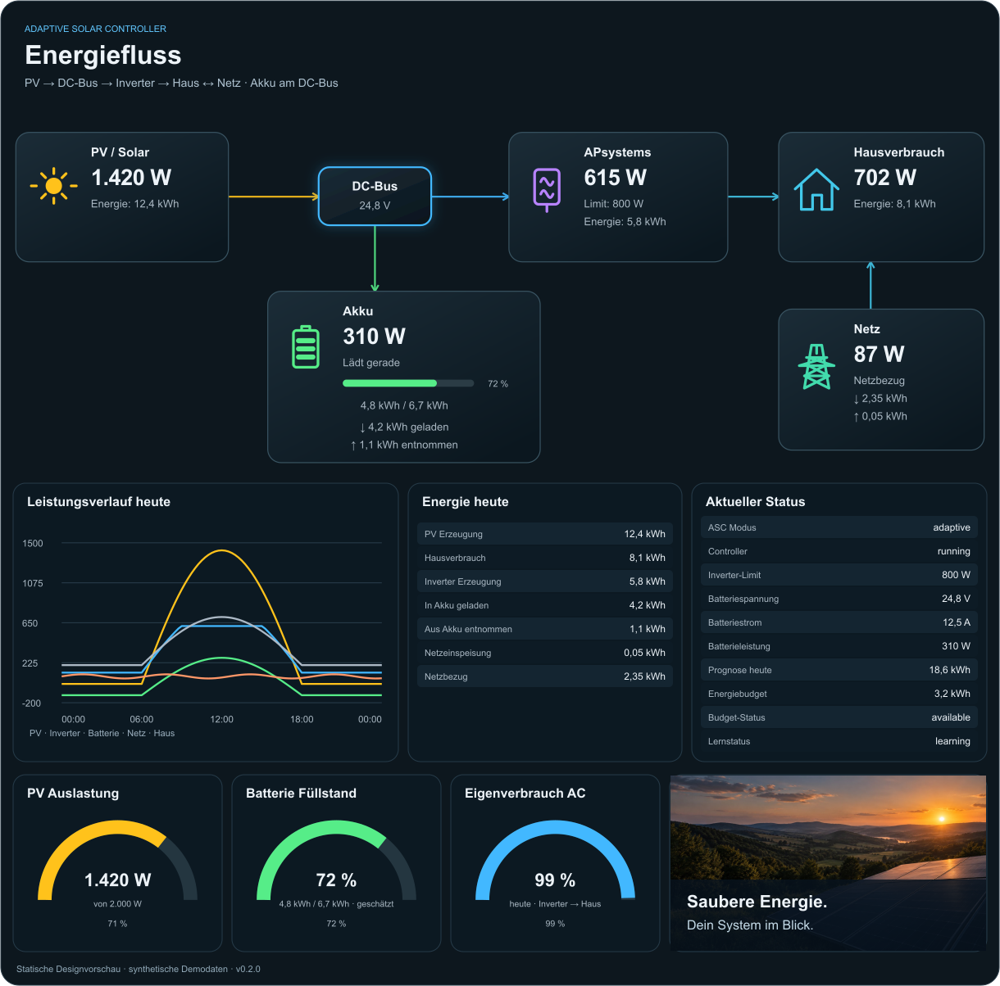

# ASC Home Assistant Cards

**v0.3.2 — vier Dashboard-Karten für ein DC-gekoppeltes Solarsystem mit Adaptive Solar Controller (ASC).**

| Karte | Typ | Zweck |
|---|---|---|
| DC-Bus-Karte | `custom:energy-flow-card-dc-bus` | Energiefluss mit Ringen, kWh-Zeitraumauswahl (Heute/Woche/Monat/Zeitraum), Live-Watt. Breit ab 721 px, darunter zweispaltig. |
| Kompaktkarte | `custom:energy-flow-card-dc-bus-compact` | Kleine Übersicht „Energieverteilung heute“ für normale Dashboard-Seiten. |
| Dashboard Light | `custom:asc-solar-dashboard-light-card` | **Für Info-Screens:** nur der Live-Energiefluss als Kacheln, immer heute, ohne Zeitraumwahl, Verlauf oder Tabellen. |
| Solar Dashboard | `custom:asc-solar-dashboard-card` | Große Seite (experimentell): Kacheln, Leistungsverlauf, Energietabelle, ASC-Status, Rundanzeigen. |




Die Vorschauen verwenden die SVG-Renderer der echten Karten und synthetische Daten. Es sind keine Screenshots einer HA-Installation. Die interaktive `demo/index.html` verwendet das fertige Produktions-Bundle und zeigt DC-Bus-Karte, Light-Variante und Dashboard mit Umschaltung auf Handybreite und Laden/Entladen. Demo-Daten werden nicht in das HACS-Bundle importiert.

## Installation über HACS (empfohlen)

1. HACS → oben rechts ⋮ → **Benutzerdefinierte Repositories** → `https://github.com/Darkwulf183/asc-home-assistant-cards` eintragen, Typ **Dashboard** → Hinzufügen.
2. „ASC Home Assistant Cards“ öffnen → **Herunterladen**.
3. HACS legt die Datei unter `/config/www/community/asc-home-assistant-cards/` ab und trägt die Ressource `/hacsfiles/asc-home-assistant-cards/asc-home-assistant-cards.js` normalerweise selbst ein. Unter Einstellungen → Dashboards → ⋮ → **Ressourcen** prüfen; falls sie fehlt, als **JavaScript-Modul** ergänzen.
4. Browser bzw. Companion-App neu laden.

Updates erscheinen danach in HACS. Alle vier Karten stecken in **einer** Datei.

**Umstieg von der manuellen Installation:** vorher die alte Ressource `/local/asc-home-assistant-cards.js…` unter Ressourcen löschen und die Datei `/config/www/asc-home-assistant-cards.js` entfernen. Werden beide Dateien geladen, gewinnt die zuerst geladene, also womöglich die alte.

### Manuell

`dist/asc-home-assistant-cards.js` nach `/config/www/` kopieren; `/local/asc-home-assistant-cards.js?v=0.3.2` als JavaScript-Modul eintragen. Nur **eine** Version dieser Ressource laden; bei Updates die Zahl hinter `?v=` erhöhen.

### Für Maintainer: Veröffentlichen

* Das GitHub-Repository muss **`asc-home-assistant-cards`** heißen: HACS sucht in `dist/` nach einer `.js`-Datei mit dem Namen des Repositorys.
* `dist/asc-home-assistant-cards.js` wird mit eingecheckt (vorher `npm run build`).
* **Releases entstehen automatisch:** Version in `package.json` erhöhen, `CHANGELOG.md` ergänzen, `npm run build`, auf `main` pushen. `.github/workflows/release.yml` legt dann Tag und Release mit der JS-Datei an; HACS zeigt das Update an.
* `.github/workflows/validate.yml` prüft bei jedem Push die HACS-Struktur und führt die Tests aus.
* Struktur laut [HACS-Dokumentation](https://hacs.xyz/docs/publish/plugin/).

### Light-Variante für den Info-Screen

```yaml
type: custom:asc-solar-dashboard-light-card
title: Solar
# show_header: false   # Überschrift/Status ausblenden
```

Am besten allein in einer **Panel-Ansicht** (Beispiel: `examples/info-screen-light.yaml`). Überschrift und Kacheln skalieren mit der Breite, auch auf großen Bildschirmen. Die Karte zeigt immer die Queransicht, auch auf schmalen Geräten, da Info-Screens quer stehen. kWh-Werte beziehen sich immer auf heute und werden alle fünf Minuten aktualisiert, Live-Watt sofort. Sensoren werden wie bei den anderen Karten unter `entities:` überschrieben.

### Kleine Karte

```yaml
type: custom:energy-flow-card-dc-bus
appearance: dark
animate: true
dashboard_path: /energy
```

Vollständige ASC-Vorgaben: `examples/asc-v0.4.3.1.yaml`. In einer breiten Karte stehen PV, DC-Bus, Inverter und Haus wie auf der Bildvorlage nebeneinander. Bis 720 px Kartenbreite wechselt sie auf eine lesbare Zweispalten-Anordnung; es ist immer genau eine Ansicht sichtbar. Für die breite Optik mehr Dashboard-Spalten zuweisen.

### Große Karte

```yaml
type: custom:asc-solar-dashboard-card
appearance: dark
animate: true
# Eigene PV-Nennleistung, z. B.:
# pv_capacity_w: 2000
```

Für die Optik der Vorlage auf einer eigenen **Panel-Ansicht** verwenden; komplette Beispiele: `examples/panel-view.yaml` und `examples/asc-solar-dashboard.yaml`. Unter 701 px verwendet der Flow-Bereich die kompakte Ringansicht, die Tabellen darunter ordnen sich responsiv an. Die Home-Assistant-Seitenleiste und obere Navigation aus dem Bild sind Teil von HA, nicht Teil der Karte.

## Design und Verhalten

* Dunkle Oberfläche, farbige Ringe bzw. Kacheln, eigene Vektorsymbole, gerichtete Pfeile und animierte Punkte.
* `appearance: dark` ist Standard und hält das gewünschte dunkle Design unabhängig vom HA-Theme. `appearance: ha` übernimmt Oberflächen-/Textfarben des HA-Themes.
* `animate: false` deaktiviert die Flusspunkte. Die Systemeinstellung für reduzierte Bewegung wird respektiert. Punkte bewegen sich nur bei einem verfügbaren Live-Wert über 1 W.
* Der Akku-Ring zeigt **geschätzte gespeicherte Energie / gelernte nutzbare Kapazität**. Kein echter BMS-SOC. Der Bogen wird auf 0–100 % begrenzt; Zahlen werden nicht verfälscht. ASC-Sentinel -1 bedeutet unbekannt.
* Die Fotokachel enthält ein mit dem eingebauten Imagegen-Tool erzeugtes Solarmotiv, lokal im Bundle eingebettet. Asset und Erzeugungsprompt: `assets/PROVENANCE.md`.
* In der kleinen Karte stehen Zeitraum-kWh im Vordergrund, im großen Live-Flow Watt. Die DC-Bus-Anzeige zeigt die gemessene Spannung. Ein separater gemessener DC-Bus-Leistungssensor liegt nicht vor; PV-Eingangsleistung wird deshalb nicht als DC-Bus-Leistung ausgegeben.
* Klick auf einen zugeordneten Knoten öffnet HA-Entity-Details. Die Karten rufen keine Steuerdienste auf.

```text
PV → DC-Bus → APsystems → Haus ↔ Netz
       ↕
      Akku
```

APsystems zeigt gemessene **AC-Ausgangsleistung/-energie**. Keine erfundene direkte Akku→Haus-Verbindung und keine Bilanzierung von MPPT-/Inverterverlusten. Die widersprüchlichen Zahlen und Richtungsbeschriftungen der generierten Referenzbilder wurden nicht als Messlogik übernommen.

## Zuordnung der Sensoren

ASC v0.4.3.1 wurde anhand der hochgeladenen ZIP ausgewertet: 82 ASC-Sensoren und 148 Dashboard-Entities sind in `docs/ASC-SENSOR-MAPPING.md` und `docs/asc-sensor-inventory.json` dokumentiert.

**Mit den Vorgaben bereits zugeordnet:** PV-Leistung/-Tageserzeugung, DC-Spannung, Batteriestrom und daraus V×A-Leistung, Batterie-Gesamtzähler, Speicherenergie/-kapazität, Inverterleistung und Netzleistung. Die große Karte ergänzt ASC-Status, Modus, Limit, Forecast, Budget und Lernstatus.

**Noch anlagenspezifisch einzutragen:** Inverter-AC-, Netzbezug- und Einspeise-Energiezähler. Diese sind in der ZIP nicht eindeutig definiert. `solar_tagesverbrauch` wird nicht als Haus- oder Inverterzähler geraten. Entity-IDs können in HA umbenannt sein; tatsächliche IDs prüfen. Keine automatische Erkennung der ASC-Konfiguration.

| Feld | Funktion |
|---|---|
| `title` | Eigene Überschrift |
| `appearance` | `dark` (Standard), `ha` |
| `animate` | Bewegte Flusspunkte, Standard true |
| `show_header` | Light-Karte: Überschrift/Status anzeigen, Standard true |
| `show_live` | Kleine Karte: zusätzliche Live-Watt anzeigen, Standard true |
| `dashboard_path` | Kleine Karte: lokaler Link, Standard `/energy` |
| `battery_positive` | `charge` (ASC), alternativ `discharge` |
| `grid_positive` | `import` (ASC), alternativ `export` |
| `pv_capacity_w` | Große Karte: eigene PV-Nennleistung in W für Auslastung |
| `entities` | Live-/ASC-Entity-Zuordnung, siehe Beispiele |
| `entities.battery_power` | Optionaler vorzeichenbehafteter W/kW-Sensor; sonst V×A live |
| `entities.home_power` | Optional gemessener Hausverbrauch; sonst Inverter + Netz live |
| `energy` | Rollen: pv, battery_charge, battery_discharge, inverter, grid_import, grid_export, home |

Keine zusätzliche Fremdkarte, kein npm-Paket zur Installation und kein visueller Konfigurationseditor nötig. YAML-Editor verwenden.

### Automatische Übernahme aus dem Home-Assistant-Energie-Dashboard

Standardmäßig liest die Karte mit `energy/get_prefs` dieselbe Energy-Konfiguration wie das originale Home-Assistant-Energie-Dashboard. Die dort als **Solar/PV** konfigurierte AC-Erzeugungsstatistik wird in dieser speziellen DC-Bus-Topologie als **Inverterenergie** dargestellt. Netzbezug und Netzeinspeisung werden ebenfalls automatisch übernommen. Der Hausverbrauch wird daraus als `Inverter + Netzbezug - Einspeisung` gebildet. Die DC-PV- und Batteriewerte kommen weiterhin aus ASC.

Damit sind für Inverter, Netzbezug und Einspeisung normalerweise keine zusätzlichen Entity-IDs nötig. Mit `auto_ha_energy: false` lässt sich die automatische Zuordnung abschalten; explizite `energy:`-Einträge haben Vorrang, `null` (z. B. `grid_export: null`) schaltet eine einzelne Rolle ab. Ist das HA-Energie-Dashboard nicht eingerichtet, entfällt nur die Automatik; die ASC-Batteriestatistiken werden weiterhin geladen.

### Energie und Zeiträume

Jede Energierolle ist `{entity: sensor.xxx, source: statistics}` oder `source: today`. `null` deaktiviert eine Vorgabe.

```yaml
energy:
  inverter:
    entity: sensor.DEIN_INVERTER_AC_GESAMTZAEHLER
    source: statistics
  grid_import:
    entity: sensor.DEIN_NETZBEZUG_GESAMTZAEHLER
    source: statistics
  grid_export:
    entity: sensor.DEINE_EINSPEISUNG_GESAMTZAEHLER
    source: statistics
```

Die obigen IDs sind **Platzhalter** und müssen ersetzt werden.

* `statistics`: Summe der Recorder-`change`-Werte in kWh, mit serverseitiger Einheitenumrechnung. Nur echte Energiezähler mit gültigen Summenstatistiken verwenden. Fehlende Werte bleiben `—`. Vorhandene Teilhistorie wird nicht hochgerechnet.
* `today`: aktueller Stand eines täglich zurückgesetzten Energiezählers. Nur in Heute sichtbar. Der PV-Tageszähler ist so vorbelegt; für längere Zeiträume auf einen geeigneten Statistikzähler umstellen.
* Heute, Woche ab Montag, Monat ab dem Ersten oder benutzerdefinierte Kalendertage (Bis einschließlich). Browser-Zeitzone; Anzeigegerät auf Anlagen-Zeitzone stellen. Keine Kopplung an den globalen HA-Energie-Datumswähler.
* Neuanfrage alle fünf Minuten. Stundenstatistiken können laufende Stunden noch nicht enthalten. Fehlende, ungültige oder unavailable-Werte sind keine Nullwerte.
* Haus-kWh: gemessener Zähler hat Vorrang, sonst nur bei vollständigen Eingängen `Inverter + Netzbezug − Einspeisung`. Gültig ohne weitere ungemessene AC-Erzeuger. Negative Ergebnisse zeigen widersprüchliche Messgrenzen statt sie zu verstecken.
* Eigenverbrauch AC: `(Inverterenergie − Einspeisung) / Inverterenergie`. Nur bei vollständigen, konsistenten Werten und positivem Inverterertrag. Das ist weder Autarkie noch DC-seitiger PV-Eigenverbrauch; keine Batterie-Flüsse doppelt addieren.

### Leistungsverlauf der großen Karte

Der Verlauf zeigt immer **heute** von Mitternacht bis jetzt, unabhängig vom kWh-Zeitraum. Er liest die HA-History-API für konfigurierte Leistungssensoren. Standard: PV, Inverter, Netz. Batterie-/Hauskurven erscheinen bei zusätzlich konfiguriertem `battery_power` bzw. `home_power`. Der Live-Hauswert und V×A-Batteriewert brauchen diese zusätzlichen Sensoren nicht.

Historische Einheiten werden pro Messpunkt umgerechnet. Unknown/unavailable unterbricht eine Kurve. Daten werden weder zu einer perfekten Kurve ergänzt noch als Prognose fortgeschrieben. Bei gelöschter Recorder-Historie bleiben Bereiche leer. Die Karte läuft bei History-/Statistikfehlern weiter.

## Lizenz

GNU General Public License v3.0 oder später (GPL-3.0-or-later), siehe [LICENSE](LICENSE). Copyright © 2026 Darkwulf183.

## Mitwirkende

* **[Darkwulf183](https://github.com/Darkwulf183)** – Idee, Anlage, Anforderungen, Tests in Home Assistant, Maintainer
* **ChatGPT** (OpenAI) – erste Versionen der Karten (v0.1–v0.2), Design und ASC-Sensorzuordnung
* **Claude** (Anthropic) – Code-Prüfung und Fehlerbehebungen (v0.2.1–v0.2.3), Light-Karte für Info-Screens, HACS-Veröffentlichung (v0.3.0–v0.3.1)

## Entwicklung

Node.js 20+; keine Paketinstallation für Build oder Tests:

```sh
npm test
npm run build
node scripts/build-demo.mjs
```

`src/shared/` enthält Messlogik, Historie und Design-Renderer. `dist/asc-home-assistant-cards.js` ist das eigenständige HACS-Bundle. `scripts/preview.mjs` erzeugt statische SVG-Designprüfungen; PNG-Ausgabe benötigt optional Sharp als Argument. Die Bildprüfung ersetzt keinen HA-Browsertest.

Siehe `docs/VALIDATION.md`, `docs/FUTURE-DASHBOARD.md` und `CHANGELOG.md` für Prüfstand und weitere Entwicklung.

### Kleine Übersichtskarte

```yaml
type: custom:energy-flow-card-dc-bus-compact
appearance: ha
animate: true
dashboard_path: /energy
```
